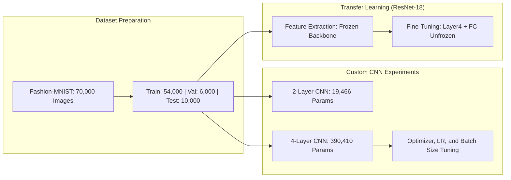

# Fashion-MNIST Image Classification with CNNs and ResNet-18

This project implements and evaluates deep learning architectures in **PyTorch** for multi-class image classification on the **Fashion-MNIST** dataset (70,000 grayscale apparel images across 10 clothing categories).

The workflow progresses from building custom Convolutional Neural Networks (CNNs) from scratch and tuning hyperparameters to applying transfer learning with a pretrained **ResNet-18** backbone.

---

## Experimental Pipeline

---

## Model Architectures and Results

### 1. Architecture Depth Comparison (5 Epochs, Adam, LR = 0.001)

| Architecture | Convolutional Layers | Trainable Parameters | Test Accuracy |
| :--- | :---: | :---: | :---: |
| **CNN2** | 2 (`32 -> 64` filters) | 19,466 | 79.05% |
| **CNN4** | 4 (`32 -> 64 -> 128 -> 256` filters) | 390,410 | **90.00%** |

---

### 2. Hyperparameter Tuning on 4-Layer CNN (3 Epochs)

| Experiment | Optimizer | Learning Rate | Batch Size | Validation Accuracy |
| :--- | :---: | :---: | :---: | :---: |
| **RMSprop Optimizer** | RMSprop | 0.001 | 64 | **88.72%** |
| **Baseline Adam** | Adam | 0.001 | 64 | 88.00% |
| **Larger Batch Size** | Adam | 0.001 | 128 | 85.62% |
| **Lower Learning Rate** | Adam | 0.0001 | 64 | 79.70% |
| **SGD Optimizer** | SGD | 0.010 | 64 | 61.68% |

---

### 3. Transfer Learning with Pretrained ResNet-18 (3 Epochs)

Images were resized to `224 x 224`, expanded to 3 channels, and normalized with ImageNet statistics before evaluating two transfer learning strategies:

| Strategy | Trainable Layers | Trainable Parameters | Test Accuracy |
| :--- | :--- | :---: | :---: |
| **Feature Extraction** | Classification Head (`fc`) only | 5,130 | 85.89% |
| **Fine-Tuning** | `layer4` (`lr=0.0001`) + `fc` (`lr=0.001`) | 8,398,858 | **92.64%** |

---

## Key Takeaways

- **Depth Improves Feature Extraction:** Increasing depth from 2 to 4 convolutional layers boosted test accuracy from **79.05%** to **90.00%**, capturing finer garment textures and shapes.
- **Adaptive Optimizers Converge Faster:** `RMSprop` and `Adam` (`lr=0.001`) significantly outperformed standard `SGD` within limited training epochs.
- **Fine-Tuning Outperforms Frozen Backbones:** Unfreezing the final residual block (`layer4`) allowed ResNet-18 to adapt ImageNet features to grayscale clothing textures, reaching the highest overall test accuracy of **92.64%**.
- **Error Analysis:** Across all models, structured footwear and bags (`Trouser`, `Sandal`, `Bag`, `Ankle boot`) achieved over **97%–99% F1-scores**, while visually similar upper-body garments (`Shirt` vs. `T-shirt/top` and `Coat`) accounted for most misclassifications.

---

## Tech Stack

- **Deep Learning:** PyTorch, Torchvision (`ResNet18_Weights`)
- **Evaluation & Visualization:** Scikit-Learn (Confusion Matrix, Classification Report), NumPy, Pandas, Matplotlib, Seaborn
- **Environment:** Google Colab (Tesla T4 GPU)

