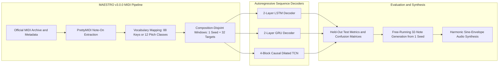
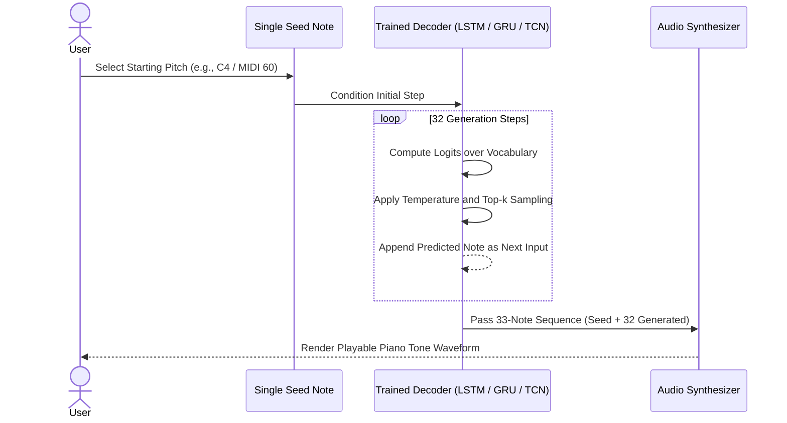

# One-to-Many Piano Sequence Generation on MAESTRO v3 (LSTM vs. GRU vs. TCN)

This repository presents a comparative deep learning study evaluating three autoregressive sequence decoders—**LSTM**, **GRU**, and **Temporal Convolutional Networks (TCN)**—on real-world piano performances from the official **MAESTRO v3.0.0** MIDI dataset.

Given **a single starting note** as input, each model generates a **32-note melodic continuation**. To study the trade-off between full register resolution and harmonic abstraction, the project implements and benchmarks two distinct vocabulary formulations across separate notebooks:

1. **Full 88-Key Piano Pitch Modeling (`MAESTRO_Real_Music_One_to_Many_LSTM_GRU_TCN.ipynb`):** Predicts exact piano keys across standard MIDI range `21–108` (`A0` to `C8`), preserving octave register transitions.
2. **12-Pitch-Class Modeling (`MAESTRO_12_Pitch_Class_One_to_Many_LSTM_GRU_TCN.ipynb`):** Maps notes via `MIDI_pitch % 12` (`C` through `B`), folding octaves together to focus on harmonic and melodic intervals.

---

## Problem Formulation and Research Scope

Generating multi-step music continuations from a single seed note is an inherently **one-to-many** sequence modeling problem—a single starting pitch can legitimately branch into dozens of valid musical phrases.

- **Real Performance Data:** Uses the official MAESTRO v3.0.0 MIDI archive with SHA-256 checksum verification and composition-disjoint train, validation, and test splits so no musical piece leaks across evaluation boundaries.
- **Monophonic Onset Stream:** Extracts note-on events sorted deterministically by onset timestamp and pitch, focusing strictly on pitch progression rather than expressive timing, velocity, or polyphonic chord durations.
- **Dual Evaluation Regimes:**
  - *Teacher-Forced Evaluation:* Measures Top-1 accuracy, Top-5 accuracy, Macro/Weighted F1-score, cross-entropy loss, perplexity, and 32-step exact sequence match against held-out performances.
  - *Free-Running Autoregressive Inference:* Supplies only one seed note at `t = 0` and feeds each model's own top-k sampled predictions back into subsequent steps, synthesizing playable piano audio waveforms for qualitative inspection.

---

## System and Training Pipeline



---

## Model Architectures Compared

All three decoders share identical learned embeddings (`pitch_embed` and `seed_embed`), optimizer settings (`Adam`, `lr = 0.001`), gradient clipping (`1.0`), and validation-loss checkpoint selection:

| Decoder Architecture | Core Mechanism | Structural Configuration |
| :--- | :--- | :--- |
| **LSTM Decoder** | Gated recurrence with separate hidden and cell memory states | 2 recurrent layers, concatenated token + seed embeddings |
| **GRU Decoder** | Lightweight gated recurrence merging cell and hidden state | 2 recurrent layers, lower parameter count than LSTM |
| **TCN Decoder** | Causal 1D convolutions with residual skip connections | 4 residual blocks with dilations `1, 2, 4, 8` (`kernel_size = 3`) |

A deterministic **Repeat-Previous-Note Baseline** is computed alongside all three neural models under teacher forcing to ground accuracy comparisons against trivial persistence.

---

## Autoregressive Inference Flow



---

## Notebook Comparison Overview

| Experiment Attribute | 88-Key Pitch Notebook | 12-Pitch-Class Notebook |
| :--- | :--- | :--- |
| **Vocabulary Size** | 88 classes (`MIDI 21–108`) | 12 classes (`C, C#, D, ..., B`) |
| **Embedding / Hidden Dim** | `48` / `96` | `64` / `128` |
| **Training Epochs** | 10 epochs | 25 epochs |
| **Performance Subset** | 160 train / 40 val / 40 test files | 400 train / 60 val / 60 test files |
| **Diagnostic Visuals** | Learning curves, metric bars, pitch trajectories | Learning curves, metric bars, 12x12 confusion matrices |
| **Interactive Demo** | `ipywidgets` live note selector + audio player | `ipywidgets` live pitch-class selector + audio player |

---

## Repository Structure

```text
MAESTRO-One-to-Many-Piano-Generation/
├── MAESTRO_Real_Music_One_to_Many_LSTM_GRU_TCN.ipynb        # 88-key full piano pitch continuation study
└── MAESTRO_12_Pitch_Class_One_to_Many_LSTM_GRU_TCN.ipynb    # 12-pitch-class harmonic continuation study
```

---

## Technology Stack

- **Deep Learning Framework:** PyTorch (`nn.LSTM`, `nn.GRU`, causal `nn.Conv1d` residual blocks)
- **Symbolic Music Processing:** `pretty_midi`
- **Metrics and Evaluation:** Scikit-Learn (Accuracy, Macro/Weighted F1, Precision, Recall, Confusion Matrix)
- **Data Analysis and Visualization:** NumPy, Pandas, Matplotlib, `ipywidgets`
- **Audio Demonstration:** NumPy harmonic waveform synthesis with `IPython.display.Audio`
- **Execution Environment:** Google Colab (Tesla T4 GPU)

---

## Dataset Attribution

- **Dataset:** Hawthorne et al., *Enabling Factorized Piano Music Modeling and Generation with the MAESTRO Dataset* (ICLR 2019), MAESTRO v3.0.0 MIDI archive (`CC BY-NC-SA 4.0`).

