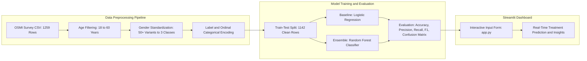
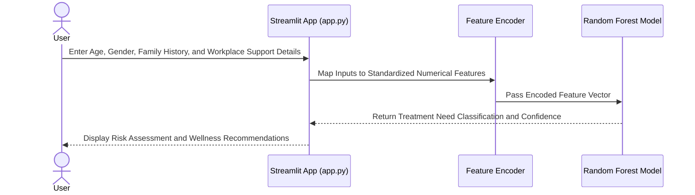

# Mental Health Treatment Prediction System

Mental Health Treatment Prediction System is an end-to-end machine learning project and interactive **Streamlit** application designed to analyze workplace and behavioral indicators and predict whether an individual may require mental health treatment.

Built using the **OSMI Mental Health in Tech Survey** dataset from Kaggle, this project moves from raw exploratory data analysis and feature engineering in Jupyter (`mental_health_project.ipynb`) to a real-time screening dashboard (`app.py`) that supports early awareness and proactive workplace well-being.

---

## Problem Statement and Motivation

High-pressure deadlines, long working hours, and burnout have made mental health a critical concern across the technology industry. Despite growing stress levels, many employees hesitate to seek professional support due to workplace stigma, privacy fears, or lack of awareness around available care options.

This project addresses these challenges through two core goals:

1. **Behavioral and Workplace Risk Analysis:** Clean and analyze real-world tech industry survey data to uncover how factors like family history, work interference, remote work, and employer benefits influence treatment-seeking behavior.
2. **Accessible Early-Screening Dashboard:** Deploy the trained classification model inside an interactive Streamlit web application (`app.py`) so users can evaluate risk indicators and receive actionable, non-clinical wellness guidance in real time.

### Sustainable Development Goal Alignment
- **UN SDG 3 (Good Health and Well-Being):** Supports the objective of ensuring healthy lives and promoting well-being at all ages by encouraging early mental health awareness and proactive support in workplace environments.

---

## Dataset Overview

The model is trained on the **OSMI Mental Health in Tech Survey** dataset sourced from Kaggle:
- **Raw Dataset Dimensions:** 1,259 survey records across 27 attributes capturing employee demographics, workplace environment, and mental health history.
- **Cleaned Dataset Dimensions:** 1,142 valid records retained after filtering unrealistic age outliers and standardizing noisy text fields.

### Key Feature Groups
- **Demographics:** `Age`, `Gender`, `Country`
- **Personal Health Indicators:** `family_history`, `treatment` (target variable)
- **Workplace Environment:** `work_interfere`, `remote_work`, `no_employees`, `tech_company`
- **Organizational Support Systems:** `benefits`, `care_options`, `wellness_program`, `seek_help`, `anonymity`, `leave`, `mental_health_consequence`, `supervisor`, `coworkers`

---

## Machine Learning Pipeline Architecture

The system separates offline preprocessing, statistical exploration, and classifier benchmarking from real-time inference inside the Streamlit web interface.



---

## Data Preprocessing and Feature Engineering

Raw survey responses contained significant noise that required systematic cleaning before model training:

1. **Age Outlier Removal:** Approximately 5% of raw records contained invalid ages (negative values, ages above 100, or placeholders like `0` and `999`). Filtering to working-age adults between **18 and 60 years** narrowed the dataset from 1,259 to 1,142 clean records.
2. **Gender Standardization:** Consolidated over 50 inconsistent free-text variations (`Male`, `M`, `cis male`, `Female`, `F`, `Woman`, `non-binary`, etc.) into three standardized categories: **Male**, **Female**, and **Other**.
3. **Categorical Encoding:** Converted binary features (`Yes` = 1, `No` = 0), standardized gender (`Male` = 0, `Female` = 1, `Other` = 2), and ordinal workplace indicators into model-ready numerical representations.
4. **Top Predictive Features Identified:** Correlation heatmaps and tree-based feature importance analysis highlighted **`work_interfere`**, **`family_history`**, **`Age`**, **`care_options`**, **`benefits`**, **`leave`**, and **`supervisor`** support as primary drivers of treatment prediction.

---

## Model Building and Evaluation Results

Two supervised classification algorithms were trained and evaluated across identical test splits: **Logistic Regression** (as a linear baseline) and **Random Forest Classifier** (to capture non-linear feature interactions across workplace and personal indicators).

| Evaluation Metric | Logistic Regression | Random Forest Classifier |
| :--- | :---: | :---: |
| **Accuracy** | 78% | **85%** |
| **Precision** | 76% | **84%** |
| **Recall** | 80% | **86%** |
| **F1-Score** | 78% | **85%** |

### Key Takeaways from Evaluation
- **Superior Recall (86%):** Random Forest significantly reduced false negatives (41 FN vs. 98 TP and 85 TN on the test confusion matrix), ensuring fewer at-risk individuals are missed during early screening.
- **Balanced Generalization:** Achieving an 85% F1-score confirms strong balance between precision and recall without overfitting to a single demographic group.

---

## Interactive Inference Flow (`app.py`)



---

## Repository Structure

```text
Mental_Health_Project/
├── app.py                                 # Streamlit interactive dashboard for live risk prediction
├── dataset/
│   └── survey.csv                         # OSMI Mental Health in Tech Survey dataset (1,259 rows)
└── notebook/
    └── mental_health_project.ipynb        # EDA, data cleaning, feature importance, and model evaluation
```

---

## Technology Stack

| Layer | Technologies and Libraries |
| :--- | :--- |
| **Programming Language** | Python 3 |
| **Data Processing** | Pandas, NumPy |
| **Visualization** | Matplotlib, Seaborn |
| **Machine Learning** | Scikit-Learn (Logistic Regression, Random Forest Classifier, Label/Ordinal Encoding, Confusion Matrix & Classification Metrics) |
| **Web Dashboard** | Streamlit (`app.py`) |
| **Notebook Environment** | Jupyter Notebook |

---

## Future Scope

- **Real-Time Cloud Deployment** - Host the Streamlit application on a cloud platform with persistent session analytics for organizational wellness check-ins.
- **Deep Learning and Gradient Boosting Benchmarks** - Expand model comparisons to include XGBoost, LightGBM, and tabular neural networks on larger multi-year OSMI survey cohorts.
- **Conversational Wellness Chatbot Integration** - Embed an interactive support assistant inside the dashboard to guide users toward stress-management techniques and workplace resources.
- **Mobile Application Companion** - Build a lightweight mobile interface for periodic self-assessments and confidential well-being tracking.

---

## Contributors

- **Chirag Salecha**
- **Achyuth RH**
- **Chanabasappa**
- **Shridevi VD**

---

## Disclaimer

This system was developed for academic and early-awareness purposes. It is not a medical or clinical diagnostic tool and should not replace professional mental health consultation.

