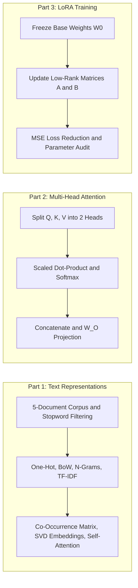
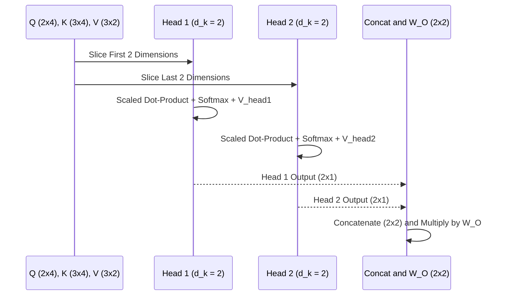

# NLP Text Representations, Multi-Head Attention, and LoRA From Scratch

This repository implements core Natural Language Processing (NLP) text representation methods, Transformer Multi-Head Scaled Dot-Product Attention, and Low-Rank Adaptation (LoRA) fine-tuning from scratch using only **NumPy** and **Matplotlib**—without relying on high-level deep learning or NLP libraries.

---

## Project Overview

The notebook is organized into three progressive sections that trace how raw text evolves from sparse frequency counts into dense contextual vectors and parameter-efficient model updates:

1. **Classical to Contextual Text Representations:** Builds seven text representation schemes on a 5-document agricultural corpus (`vocab_size = 8`).
2. **Multi-Head Scaled Dot-Product Attention:** Splits Query, Key, and Value matrices across two attention heads, applies numerically stable softmax, concatenates head outputs, and projects the final representation.
3. **LoRA Parameter-Efficient Fine-Tuning:** Trains low-rank adaptation matrices `A` and `B` (`rank = 1`) via manual gradient descent while keeping the base weight matrix `W0` frozen.

---

## Experimental Pipeline



---

## Module Breakdown and Key Results

### 1. Text Representation Progression (NumPy Only)

Evaluated across a 5-document corpus (`mildew affects tomatoes`, `mildew affects potatoes`, `sun affects tomatoes`, `tomatoes grow in sun and rain`, `potatoes need sun`) with an 8-word vocabulary:

| Representation Method | Mathematical Formulation | Key Finding in Notebook |
| :--- | :--- | :--- |
| **One-Hot Encoding** | `8 x 8` identity basis vectors | Orthogonal word vectors with zero semantic similarity |
| **Bag-of-Words (BoW)** | `5 x 8` term count matrix | Produces identical vectors for `"mildew affects tomatoes"` and `"tomatoes affects mildew"`, losing word order |
| **N-Grams (`n = 1, 2, 3`)** | Sliding token tuples | Captures local word order (`[('mildew', 'affects')]` vs. `[('tomatoes', 'affects')]`) |
| **TF-IDF + Cosine Search** | `TF * log(N / DF)` | Ranks **Document 1** (`0.8991`) highest for query `"mildew tomatoes"` and zeroes out unseen query words (`"fertilizer"`) |
| **Co-Occurrence Matrix** | Symmetric sliding window (`window = 1, 2, 3`) | Total co-occurrence counts grow from `22` (`window=1`) to `34` (`window=2`) and `36` (`window=3`) |
| **SVD Word Embeddings** | `U[:, :3] * sqrt(S[:3])` | Compresses 8D sparse rows into 3D dense vectors where `"tomatoes"` and `"potatoes"` achieve `1.000` cosine similarity |
| **Contextual Embeddings** | Self-attention (`Q = K = V = X`) | Shifts the representation of `"affects"` from `[-0.275, -1.248, 0.341]` in sentence 1 to `[-0.206, -1.248, 0.341]` in sentence 2 |

---

### 2. Multi-Head Scaled Dot-Product Attention



- **Attention Weight Verification:** Row-wise softmax weights sum strictly to `1.0` across both heads.
- **Final Projected Output (`2 x 2`):** Produces `[[1.203, 1.604], [1.000, 1.198]]` after concatenating `head1_final` and `head2_final` and applying output projection `W_O`.

---

### 3. Low-Rank Adaptation (LoRA) Fine-Tuning

Demonstrates parameter-efficient adaptation on a `4 x 4` frozen identity matrix `W0` using rank `r = 1` (`A` of shape `4 x 1`, `B` of shape `1 x 4`) over 5 gradient descent steps (`lr = 0.01`):

| Metric | Value |
| :--- | :--- |
| **Initial MSE Loss** | `3.000000` |
| **Final MSE Loss (Step 5)** | `2.993876` |
| **Base Matrix `W0` Status** | Frozen (`np.array_equal(W0, W0_original) == True`) |
| **Full Fine-Tuning Parameters** | `16` (`4 x 4`) |
| **LoRA Trainable Parameters** | `8` (`4 + 4`, a **50.00%** parameter reduction) |

---

## Repository Structure

```text
Transformers-From-Scratch/
└── Transformers.ipynb    # Complete NumPy implementation of NLP representations, Multi-Head Attention, and LoRA
```

---

## Technology Stack

- **Core Computation:** Python 3, NumPy (matrix multiplication, SVD, manual backpropagation, numerically stable softmax)
- **Visualization:** Matplotlib (cosine similarity ranking bar chart, co-occurrence heatmap, LoRA loss curve, parameter comparison plot)
- **Environment:** Google Colab
